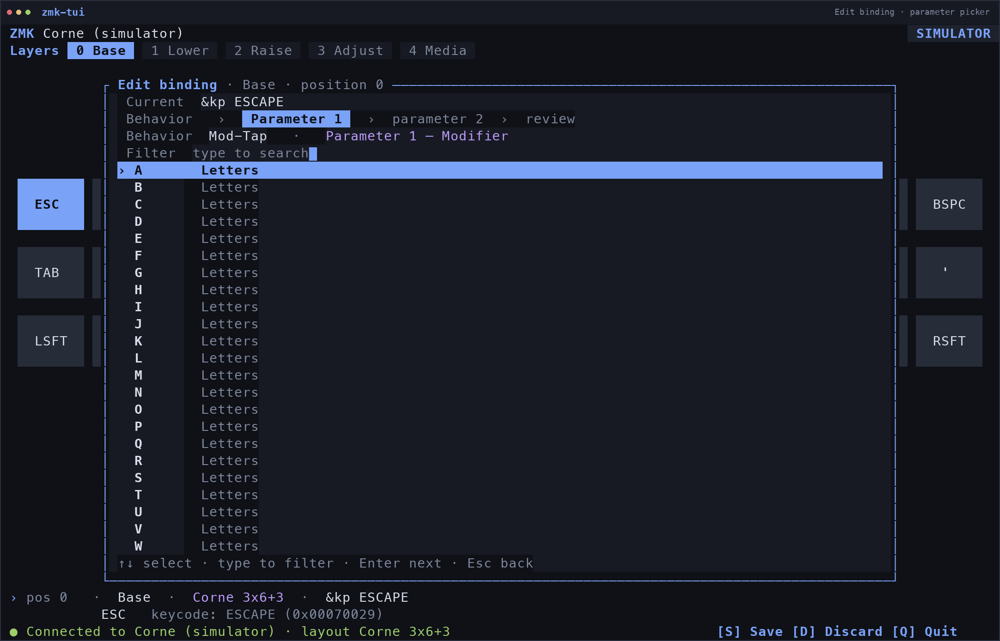
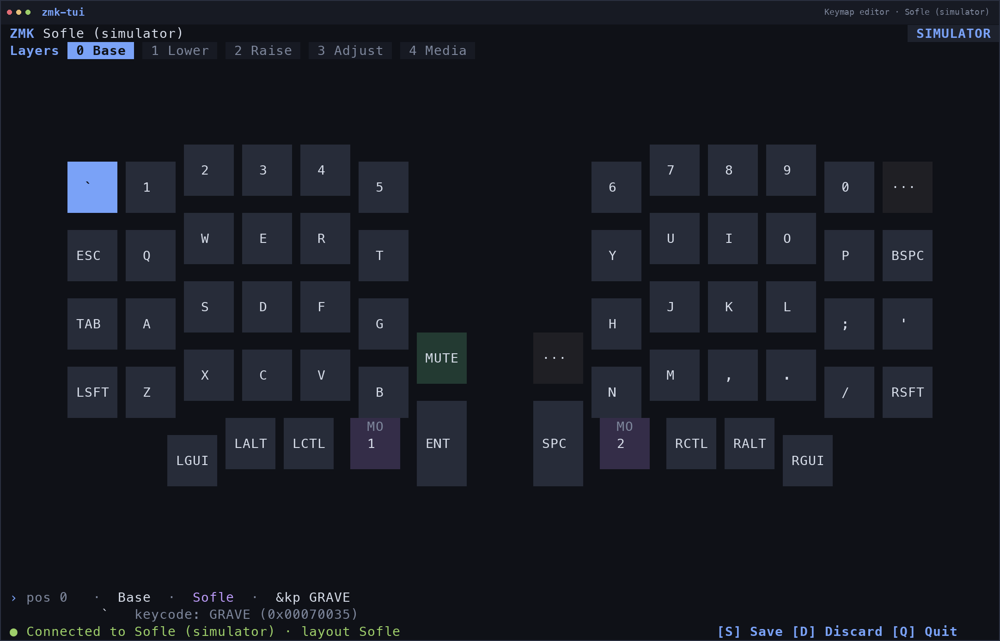

# zmk-tui

A terminal UI for editing [ZMK](https://zmk.dev) keymaps **live**, over USB or
Bluetooth LE. It renders the keyboard's real physical layout and lets you change
bindings, layers and layouts without leaving the terminal.


For architecture, protocol, testing and contribution details, see the
[developer guide](docs/developer-guide.md).

## Features

- **USB and Bluetooth LE** — connect over a cable or wirelessly.
- **The real layout** — the keyboard reports its own key geometry; the TUI draws
  box colours, split gaps and thumb clusters.
- **Binding editor** — searchable behavior list followed by a searchable
  keycode / layer / constant / numeric parameter picker.
- **Layer manager** — add, rename, remove and reorder layers; jump between them
  with `Tab`, `[`/`]` or `0`–`9`.
- **Physical layout picker** — switch between the layouts defined in firmware.
- **Save, discard, restore stock** — edits apply live; `s` persists them, `d`
  reverts unsaved changes, `R` restores the firmware's stock settings.
- **Mouse support** — click a key to select and double-click to edit, click
  layer tabs, use the footer Save/Discard/Quit buttons, click or double-click
  list rows, and scroll with the wheel.
- **Lock-aware** — detects `&studio_unlock` state, explains what to press, and
  resumes automatically when the keyboard unlocks.
- **Works with the keyboard's layout** — Corne, Sofle or any other ZMK Studio
  keyboard, without a per-board configuration file.
- **No hardware needed to try it** — the built-in simulator ships with Corne
  and Sofle.

| Binding: choose behavior | Binding: choose keycode |
| --- | --- |
|  |  |

## Vial keyboards (experimental)

The same editor can also edit keymaps on [Vial](https://get.vial.today)
keyboards over USB raw HID. Start the in-process demo without hardware:

```bash
cargo run -- --simulate-vial
```

Real keyboards are detected automatically: ZMK Studio keyboards appear as
`ZMK Studio · …` serial ports and Vial keyboards as `Vial · …` raw-HID
interfaces. When exactly one keyboard is visible, the app connects to it on
startup using the right protocol — no flag or standard selection needed. If
several are visible, the connect screen lists them with their standard; select
a row and press Enter. A keyboard that exposes both interfaces appears twice,
so both standards are available from the same screen. `--vial` remains as a
shortcut that opens the first Vial interface directly.

```bash
cargo run -- --vial
```

Vial support is intentionally keycode-only: bindings, layers (fixed count) and
save/discard/reset work through the same UI. Macros, tap dance, combos, key
overrides, QMK settings, encoders and physical-layout switching are not edited;
keycodes this editor cannot express are shown as raw `0xNNNN` values and are
preserved exactly. Edits are staged and only written on save, with read-back
verification. See the [Vial integration notes](docs/vial-integration-feasibility.md)
for protocol details, limitations and the hardware test checklist.

`--list` for Vial devices (read-only) is available through the probe:

```bash
cargo run --example vial_probe -- --list
cargo run --example vial_probe -- --real
```

## Supported keyboards

Any keyboard whose firmware exposes ZMK Studio works. The editor reads the
physical layout from the device, so there is no board-specific code or config.

The built-in Sofle simulator has 60 key positions (including both encoder push
buttons), column stagger, rotated thumb keys, and five layers: Base, Lower,
Raise, Adjust and Media.



## Requirements

### Firmware

Build the keyboard with ZMK Studio enabled. For USB Studio support, include the
`studio-rpc-usb-uart` snippet:

```yaml
# build.yaml (GitHub Actions), central/left side only for split keyboards
include:
  - board: nice_nano//zmk
    shield: corne_left
    snippet: studio-rpc-usb-uart
    cmake-args: -DCONFIG_ZMK_STUDIO=y
  - board: nice_nano//zmk
    shield: corne_right
```

Local build:

```bash
west build -b nice_nano//zmk -S studio-rpc-usb-uart -- \
  -DSHIELD=corne_left -DCONFIG_ZMK_STUDIO=y
```

- The `studio-rpc-usb-uart` snippet enables the USB transport.
- Bluetooth uses the Studio GATT service and needs no extra snippet.
- Add `&studio_unlock` to a key or combo. ZMK Studio refuses keymap changes
  until it is pressed.
- On a split keyboard, enable Studio on the **central** side only.
- If the keyboard is connected over both USB and BLE, use the same output
  endpoint for Studio (`&out OUT_USB` or `&out OUT_BLE`).

### Host

- Rust **1.85+** (edition 2024) to build from source.
- macOS: allow Bluetooth access for your terminal when prompted.
- Linux: BlueZ/DBus and udev headers may be needed (`libdbus-1-dev`,
  `libudev-dev`), and your user may need `dialout`/`uucp` membership for the
  serial port.
- Windows: the same protocol applies, but this build has not been tested there.

## Build and run

```bash
cargo build --release

# Pick a device interactively
./target/release/zmk-tui

# Connect directly
./target/release/zmk-tui --port /dev/cu.usbmodem1234
./target/release/zmk-tui --ble "Corne"

# Inspect what is visible to the host
./target/release/zmk-tui --list

# Try the UI with no keyboard attached
./target/release/zmk-tui --simulate           # Corne
./target/release/zmk-tui --simulate sofle     # Sofle
```

`--ble` matches a case-insensitive substring of the device name and fails if
several keyboards match. The keyboard must already be connected to this
computer; ZMK does not normally advertise the Studio service, so a keyboard
connected to another host will not appear in the Bluetooth list.

## Using zmk-tui

### Keymap screen

| Key | Action |
| --- | --- |
| `↑` `↓` `←` `→` / `h` `j` `k` `l` | Move the selection by physical geometry |
| `g` / `G`, `Home` / `End` | First / last key |
| `Tab` / `Shift-Tab`, `[` / `]` | Next / previous layer |
| `0`–`9` | Jump to a layer |
| `Enter` | Edit the selected binding |
| `L` | Layer manager |
| `p` | Physical layout picker |
| `u` | Unlock instructions |
| `s` | Save changes to the keyboard |
| `d` | Discard unsaved changes (confirm) |
| `R` | Restore stock firmware settings (confirm) |
| `?` | Help |
| `q` / `Ctrl-C` | Quit (prompts if unsaved) |

### Binding editor

Type to filter, use `↑`/`↓` to select, `Enter` to advance and `Esc` to go back.
For keycodes, filtering matches ZMK macro names, aliases and labels (`ent`,
`spc`, `vol+`, `!`, ...). The wizard ends on a review screen showing the exact
devicetree-style binding before it is applied.

### Mouse

| Action | Effect |
| --- | --- |
| Click a key | Select that key |
| Double-click a key | Open the binding editor |
| Click a layer tab | Switch layers |
| Click `[S] Save` / `[D] Discard` / `[Q] Quit` | Run the footer action |
| Click a list row | Select it |
| Double-click a list row | Activate it (choose/switch/advance) |
| Wheel over a list | Move the selection |
| Click a confirm choice | Run that action |

Mouse capture is enabled while the TUI is running. Hold **Shift** while
dragging to select terminal text normally. Layer-manager add/rename/remove/move
shortcuts (`a`, `r`, `x`, `J`/`K`) remain keyboard actions.

### Layer manager

`a` add · `r` rename · `x` remove · `J`/`K` move down/up · `Enter` switch ·
`Esc` close.

The layer bar shows the layers reported by the firmware, scrolling (`‹`/`›`) when
they do not all fit. The manager can add layers only into the free slots the
firmware advertises; on real hardware, see
the [developer guide](docs/developer-guide.md#layers-slots-and-storage) for
reserved-layer setup.

### Editing and saving

- Edits are applied to the live keymap immediately, but are not persisted until
  you save.
- ZMK Studio is locked by default; press the key or combo bound to
  `&studio_unlock`. The app detects the unlock automatically.
- Saved Studio settings override the compiled `.keymap` on subsequent boots.
  Use `R` to restore the firmware's stock settings.
- Discarding reverts to the last saved settings, not to the compiled keymap.
- The physical layout is detected automatically. If firmware exposes several
  layouts, use `p` to switch between them.

## Troubleshooting

- **No USB serial devices** — use a data cable, not a charge-only one. On Linux,
  grant serial access (`dialout` or `uucp` group).
- **“Device or resource busy”** — another process owns the serial port. Close
  ZMK Studio, a browser tab using Web Serial, a serial monitor or another
  `zmk-tui`, then retry. `lsof /dev/cu.usbmodemXXXX` shows the holder.
- **“the keyboard did not respond in time” over Bluetooth** — another Studio
  client may still own the BLE session, or the keyboard's GATT state is stale.
  Close other Studio clients, power-cycle the keyboard and retry. The detailed
  force-release procedure is in the
  [developer guide](docs/developer-guide.md#ble-session-stuck-timeout).
- **Connected but the keyboard does not answer** — some boards expose both a
  console and a Studio CDC-ACM port; try the other USB serial device.
- **Bluetooth list is empty** — the keyboard must be connected to this computer,
  the firmware must enable Studio, and the terminal needs Bluetooth permission.
- **“Keyboard is locked”** — add `&studio_unlock` to the keymap and press it.
- **“No storage space left” when saving** — ZMK settings storage is full; free
  space or reduce the number of saved settings.
- **“RPC not found”** — the firmware is too old or does not have Studio enabled;
  rebuild with `CONFIG_ZMK_STUDIO=y`.

## Known limitations

- Rotated keys are rendered unrotated; navigation still uses physical centres.
- Rotary encoder bindings are not exposed by the current Studio protocol.
  Sofle's two encoder push-buttons are ordinary editable key positions.
- A behavior's first advertised parameter signature is used.
- There is no per-edit undo history; `d` discards all unsaved changes.
- One keyboard can be edited at a time.
- BLE requires the keyboard to be connected to this host first.
- Hardware paths implement the documented protocol but were validated against
  the bundled simulator, not every ZMK board.

## Documentation

- [Developer guide](docs/developer-guide.md) — architecture, protocol,
  transports, layout/layer internals, build, testing and formal verification.
- [CRAP report](docs/crap-summary.md) — complexity and coverage refactoring.
- [Mutation testing](docs/mutation-report.md) — cargo-mutants results.
- [Formal verification](docs/formal-verification.md) — Kani and state-machine
  candidates.

## License

MIT. See [LICENSE](LICENSE) and [THIRD_PARTY.md](THIRD_PARTY.md).

ZMK, ZMK Studio, and the vendored protocol/keycode definitions are MIT-licensed
projects by The ZMK Contributors. This project is not affiliated with or
endorsed by the ZMK project.
