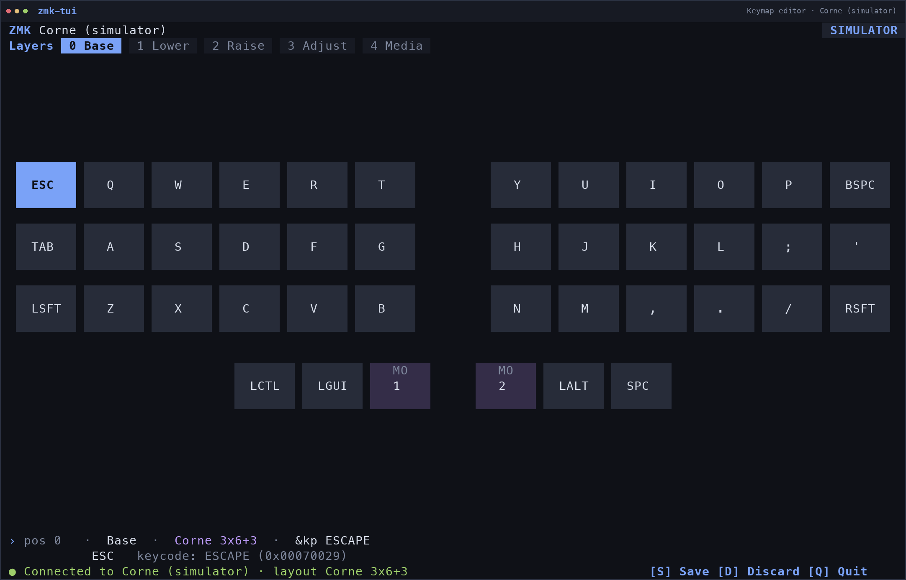
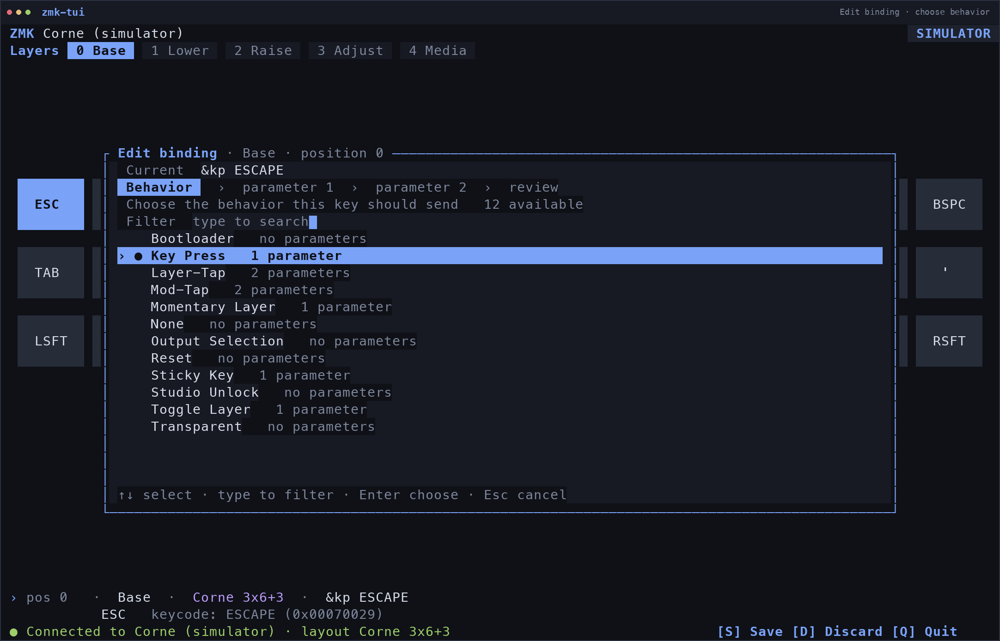

# zmk-tui

A terminal UI for editing [ZMK](https://zmk.dev) keymaps **live**, over USB or
Bluetooth LE. It speaks the [ZMK Studio](https://zmk.dev/docs/features/studio)
RPC protocol directly, renders the keyboard's real physical layout, and lets
you change bindings, layers and layouts without leaving the terminal.



## Features

- **USB and Bluetooth** — CDC-ACM serial and the Studio GATT service
  (`00000000-0196-6107-c967-c5cfb1c2482a`).
- **The real layout** — the keyboard reports its physical key geometry; the TUI
  draws it with box colours, split gaps and thumb clusters.
- **Binding editor** — searchable behavior list, then a searchable keycode /
  layer / constant / numeric parameter picker driven by the device's own
  behavior metadata.
- **Layer manager** — add, rename, remove and reorder layers; jump between
  layers with `Tab`, `[`/`]` or `0`–`9`. The built-in boards expose layers
  0–4 (Base, Lower, Raise, Adjust, Media), and real firmware can report more.
- **Physical layout picker** — switch between layouts defined in firmware.
- **Save, discard, restore stock** — edits apply live; `s` persists them, `d`
  reverts unsaved changes, `R` restores the firmware's stock settings.
- **Mouse support** — click a key to select and double-click to edit, click
  layer tabs, use the footer Save/Discard/Quit buttons, click or double-click
  list rows, and scroll with the wheel. Confirm dialog choices are clickable.
- **Lock-aware** — detects `&studio_unlock` state, explains what to press, and
  resumes automatically when the keyboard unlocks.
- **Layout-agnostic** — anything the firmware reports works: Corne (42), Sofle
  (60), or your own split. The built-in simulator ships with both a Corne and
  a Sofle, so you can try either without hardware.
- **No hardware needed to try it** — `--simulate corne` or `--simulate sofle`.

| Binding: choose behavior | Binding: choose keycode |
| --- | --- |
|  |  |

### Sofle

The editor reads the physical layout from the keyboard, so a Sofle works over
USB or Bluetooth exactly like a Corne — there is no per-board code or config.
The simulator's Sofle has 60 key positions (including both encoder push
buttons), column stagger, rotated thumb keys, and five layers
(Base, Lower, Raise, Adjust, Media).


## Requirements

### Firmware

The keyboard must be built with ZMK Studio enabled:

```yaml
# build.yaml (GitHub Actions), central/left side only for split keyboards
include:
  - board: nice_nano//zmk
    shield: corne_left
    snippet: studio-rpc-usb-uart
    cmake-args: -DCONFIG_ZMK_STUDIO=y
  - board: nice_nano//zmk
    shield: corne_right
```

Local build:

```bash
west build -b nice_nano//zmk -S studio-rpc-usb-uart -- \
  -DSHIELD=corne_left -DCONFIG_ZMK_STUDIO=y
```

- The `studio-rpc-usb-uart` snippet enables the USB transport. It also keeps
  every behavior in the firmware so Studio can assign it.
- Bluetooth uses the Studio GATT service and needs no extra snippet.
- Add `&studio_unlock` to a key or combo. ZMK Studio refuses keymap changes
  until it is pressed.
- On a split keyboard, enable Studio on the **central** side only.
- If the keyboard is connected over both USB and BLE, select the same output
  endpoint you use for Studio (`&out OUT_USB` or `&out OUT_BLE`).
- Corne, Sofle, and any other shield work without app-side layout changes: the
  firmware exposes the physical layout and the TUI renders it.

### Host

- Rust **1.85+** (edition 2024).
- macOS: allow Bluetooth access for your terminal when prompted.
- Linux: BlueZ/DBus and udev headers may be needed (`libdbus-1-dev`,
  `libudev-dev`), and your user may need `dialout`/`uucp` membership for the
  serial port.
- Windows: the same protocol applies, but this build has not been tested there.

## Build and run

```bash
cargo build --release

# Pick a device interactively
./target/release/zmk-tui

# Connect directly
./target/release/zmk-tui --port /dev/cu.usbmodem1234
./target/release/zmk-tui --ble "Corne"

# Inspect what is visible to the host
./target/release/zmk-tui --list

# Try the UI with no keyboard attached
./target/release/zmk-tui --simulate           # Corne
./target/release/zmk-tui --simulate sofle     # Sofle
```

`--ble` matches a case-insensitive substring of the device name and fails if
several keyboards match. Bluetooth discovery only sees keyboards that are
already connected to this computer: ZMK advertises its HID and battery
services, not the Studio service, so a keyboard talking to another host cannot
be discovered.

## Controls

### Keymap screen

| Key | Action |
| --- | --- |
| `↑` `↓` `←` `→` / `h` `j` `k` `l` | Move the selection by physical geometry |
| `g` / `G`, `Home` / `End` | First / last key |
| `Tab` / `Shift-Tab`, `[` / `]` | Next / previous layer |
| `0`–`9` | Jump to a layer |
| `Enter` | Edit the selected binding |
| `L` | Layer manager |
| `p` | Physical layout picker |
| `u` | Unlock instructions |
| `s` | Save changes to the keyboard |
| `d` | Discard unsaved changes (confirm) |
| `R` | Restore stock firmware settings (confirm) |
| `?` | Help |
| `q` / `Ctrl-C` | Quit (prompts if unsaved) |

### Binding editor

Type to filter, `↑`/`↓` to select, `Enter` to advance, `Esc` to go back. For
keycodes, filtering matches ZMK macro names, aliases and labels (`ent`, `spc`,
`vol+`, `!`, ...). The wizard ends on a review screen showing the exact
devicetree-style binding before it is applied.

### Mouse

| Action | Effect |
| --- | --- |
| Click a key | Select that key |
| Double-click a key | Open the binding editor |
| Click a layer tab | Switch layers |
| Click `[S] Save` / `[D] Discard` / `[Q] Quit` | Run the footer action |
| Click a list row | Select it |
| Double-click a list row | Activate it (choose/switch/advance) |
| Wheel over a list | Move the selection |
| Click a confirm choice | Run that action |

Mouse capture is enabled while the TUI is running. Hold **Shift** while
dragging to select terminal text normally. Layer-manager add/rename/remove/move
shortcuts (`a`, `r`, `x`, `J`/`K`) remain keyboard actions.

### Layer manager

`a` add · `r` rename · `x` remove · `J`/`K` move down/up · `Enter` switch ·
`Esc` close.

## Troubleshooting

- **No USB serial devices** — use a data cable, not a charge-only one. On Linux,
  grant serial access (`dialout` or `uucp` group).
- **“Device or resource busy”** — another process owns the serial port. The TUI
  needs exclusive access, so close ZMK Studio (web or native), a browser tab
  using Web Serial, a serial monitor, or another `zmk-tui` instance, then press
  Enter to retry. On macOS/Linux, `lsof /dev/cu.usbmodemXXXX` shows the holder.
- **“the keyboard did not respond in time” over Bluetooth** — another Studio
  client may still own the BLE RPC session, or the keyboard may be connected to
  another host/profile. This is not a lock: the app subscribes and writes, but
  receives no indications. Force-release the session in this order:

  1. Quit every `zmk-tui` (`pgrep -fl zmk-tui`; then
     `pkill -TERM -f zmk-tui`, or `pkill -KILL -f zmk-tui` if it does not
     exit). A dirty quit prompt can leave the old instance connected.
  2. Quit ZMK Studio (web and native) and any browser tab using Web Bluetooth.
     Quitting the browser is the only way to release its GATT client.
  3. Power-cycle the keyboard (off/on). This clears the firmware-side GATT
     subscription/RPC state and is the most reliable reset.
  4. Toggle macOS Bluetooth off and on (menu bar), or install `blueutil` and
     run `blueutil -p 0; sleep 2; blueutil -p 1`. The keyboard HID connection
     drops and reconnects.
  5. If it still fails, remove the keyboard from System Settings → Bluetooth
     and re-pair it. On the keyboard, clear the Mac bond (for example
     `&bt BT_CLR`), then pair again.

  Set `ZMK_TUI_BLE_DEBUG=1` before launching to log BLE TX/RX to stderr; a
  subscription followed by TX but no RX confirms the session is owned
  elsewhere. USB is a reliable fallback once the serial port is free.
- **Connected but the keyboard does not answer** — some boards expose both a
  console and a Studio CDC-ACM port. Try the other USB serial device. The
  `studio-rpc-usb-uart` snippet is required for the USB transport.
- **Bluetooth list is empty** — the keyboard must be connected to this
  computer, the firmware must enable Studio, and the terminal needs Bluetooth
  permission (macOS prompts the first time).
- **“Keyboard is locked”** — add `&studio_unlock` to the keymap and press that
  key or combo. The app detects the unlock automatically.
- **“No storage space left” when saving** — ZMK settings storage is full; free
  space or reduce the number of saved settings.
- **“RPC not found”** — the firmware is too old or does not have Studio
  enabled; rebuild with `CONFIG_ZMK_STUDIO=y`.

## Important ZMK Studio semantics

- Edits are applied to the **live** keymap immediately. They are not persisted
  until `save` writes them to the keyboard's settings storage.
- ZMK Studio is locked by default. Press the key or combo bound to
  `&studio_unlock`; the app polls the lock state and also listens for the
  unlock notification.
- Once Studio settings have been saved, they **override the compiled
  `.keymap`** on subsequent boots. To go back to the keymap compiled into the
  firmware, use `R` (restore stock settings).
- Discarding reverts to the last saved settings, not to the compiled keymap.

## Layout detection

Layout selection is automatic and comes from the keyboard, not from a fixed
list of supported boards:

1. After connecting (and unlocking, if necessary), the client calls
   `keymap.get_keymap` and `keymap.get_physical_layouts`.
2. The active physical layout's key geometry is used directly for drawing and
   arrow-key navigation. Its display name is shown in the selection line, for
   example `pos 0 · Base · Sofle · &kp GRAVE`.
3. If the firmware reports several physical layouts, `p` lists and switches
   between them (`set_active_physical_layout`).
4. Firmware that does not implement the physical-layout RPC, or reports none,
   falls back to a generic 10-column grid; editing still works.

The device's `CONFIG_ZMK_KEYBOARD_NAME` is shown as the device name. ZMK Studio
does not expose a board model, so the app does not need one — geometry and
layout names are authoritative.

While a keyboard is locked, Studio refuses the keymap/layout RPCs; the app
shows the unlock instructions and loads the layout automatically once
`&studio_unlock` is pressed.

## Layers

The TUI does not impose a layer limit: it shows every layer the firmware
reports, and the layer manager can add layers into the free slots Studio
advertises.

The built-in simulators expose five layers:

| Index | Name | Notes |
| --- | --- | --- |
| 0 | Base | main keymap |
| 1 | Lower | symbols/numbers |
| 2 | Raise | navigation/media and `MO(3)`/`MO(4)` thumb keys |
| 3 | Adjust | function keys |
| 4 | Media | consumer media keys |

Select them with `Tab`/`Shift-Tab`, `[`/`]`, or `0`–`4`. The layer bar shows a
window of layers around the active one when there are more than seven.

On real hardware, ZMK Studio only exposes layers that exist in the devicetree.
To use five or more layers, either define them in your `.keymap`, or reserve
future layers for Studio:

```dts
keymap {
    compatible = "zmk,keymap";

    base { display-name = "Base"; bindings = /* ... */; };
    /* ... four more layers ... */

    extra1 {
        status = "reserved";
    };
};
```

Reserved layers are ignored by normal builds but can be activated through ZMK
Studio. In the TUI, use `L` to open the layer manager and `a` to add into a
free slot; `available_layers` is how many slots the firmware reports. The app
cannot create more layers than the firmware was built to allow.

## How it works

- **Framing** — `0xAB` start, `0xAC` escape, `0xAD` end; reserved bytes are
  escaped with `0xAC` (`src/protocol/frame.rs`).
- **Messages** — protobuf definitions vendored from
  [zmk-studio-messages](https://github.com/zmkfirmware/zmk-studio-messages),
  compiled with `prost` (`proto/zmk`, `build.rs`).
- **USB** — CDC-ACM at 9600 baud via `serialport`, with dedicated reader and
  writer threads (`src/transport/serial.rs`).
- **Bluetooth** — the Studio GATT service and its single write/indicate
  characteristic via `bluest` (`src/transport/ble.rs`). The adapter that
  discovered a device stays alive with it, because bluest's CoreBluetooth
  backend creates one central per adapter.
- **RPC client** — request IDs, one request at a time, notifications for lock
  and unsaved state, typed errors including `UnlockRequired`
  (`src/client.rs`).
- **TUI** — `ratatui`/`crossterm` with an async event loop; all device work
  happens in spawned tasks so the UI stays responsive
  (`src/tui/`).

The protocol is ZMK Studio messages v3. There is no firmware version handshake;
older firmware that does not implement a request surfaces an
“RPC not found” error.

## Testing

```bash
cargo test                      # 83 Rust unit/integration tests + Gherkin
cargo test --test cucumber      # 4 Gherkin scenarios / 31 steps
cargo clippy --all-targets
```

Coverage includes:

- frame escaping, chunk boundaries, noise resynchronisation;
- the full RPC client against an in-process simulated keyboard;
- keyboard geometry and directional navigation;
- keycode parsing/labels/search, all modifier symbols and custom-behavior labels;
- modal parameter ranges, layer/constant/HID values, layer rename and layout
  selection;
- connect-screen keyboard/mouse navigation and mouse layer selection;
- end-to-end UI flows (connect, navigate, edit, save, discard, add/remove
  layer, switch layout, restore stock, quit prompt) rendered with ratatui's
  `TestBackend`;
- executable Gherkin acceptance features for binding edits, unsaved-change
  confirmation, layer shortcuts and the Sofle board.

The Gherkin features live in `tests/features/`; their step definitions are in
`tests/cucumber.rs` and drive the real `App`/`TestBackend` path.

The simulator (`src/simulator.rs`) implements the same wire protocol as the
firmware, including locking, notifications, save/discard and layer operations.
It ships with a 42-key Corne (two physical layouts) and a 60-position Sofle
(five layers, column stagger and rotated thumb keys).

### Coverage and CRAP

[`tools/crap.py`](tools/crap.py) combines `cargo llvm-cov --json` with lizard's
cyclomatic complexity to rank functions by CRAP:

```bash
cargo llvm-cov --all-targets --json --output-path /tmp/coverage.json
PYTHONPATH=/tmp/zmk-py python3 tools/crap.py /tmp/coverage.json \
  --top 30 --output docs/crap-report.md
```

The baseline is in [`docs/crap-baseline.md`](docs/crap-baseline.md), the current
ranking in [`docs/crap-report.md`](docs/crap-report.md), and the refactoring
notes in [`docs/crap-summary.md`](docs/crap-summary.md). High-CRAP FFI/OS/entry
points are documented there rather than hidden with coverage exclusions.

### Mutation testing

`cargo-mutants` is configured in [`.cargo/mutants.toml`](.cargo/mutants.toml).
The focus is pure keymap/protocol logic; terminal, rendering and hardware
transport layers are excluded because their failures need hardware checks.

```bash
cargo mutants -f src/keycodes/mod.rs -- --lib
```

Results and equivalent-mutant notes are in
[`docs/mutation-report.md`](docs/mutation-report.md).

### Formal verification

The frame codec is the best bounded-verification target: it is tiny,
synchronous and allocation-bounded. Kani harnesses live in
`src/verification.rs`; run them with:

```bash
cargo kani --harness frame_round_trips_arbitrary_payload
cargo kani --harness arbitrary_serial_noise_never_panics
cargo kani --harness encoded_frame_shape_is_well_formed
```

[`docs/formal-verification.md`](docs/formal-verification.md) maps the remaining
code to Kani, Prusti/Creusot, TLA+/Stateright and property-testing options, and
explains why the TUI, CoreBluetooth and serial layers are not suitable for
deductive verification.

### Regenerating screenshots

```bash
cargo run --example screens -- /tmp/zmk-shots
python3 tools/render_screenshot.py /tmp/zmk-shots docs
```

## Known limitations

- Rotated keys are rendered unrotated (the grid uses the key's unrotated
  bounding box); navigation still uses physical key centres.
- Rotary encoder bindings are not exposed by the current Studio protocol.
  Sofle's two encoder push-buttons are ordinary key positions and are editable.
- A behavior's first advertised parameter signature is used.
- Edits apply immediately; there is no per-edit undo history. `d` discards all
  unsaved changes.
- One keyboard at a time.
- BLE requires the keyboard to be connected to this host first.
- Hardware paths implement the documented protocol but were validated against
  the bundled simulator, not every ZMK board.

## License

MIT. See [LICENSE](LICENSE) and [THIRD_PARTY.md](THIRD_PARTY.md).

ZMK, ZMK Studio, and the vendored protocol/keycode definitions are MIT-licensed
projects by The ZMK Contributors. This project is not affiliated with or
endorsed by the ZMK project.
